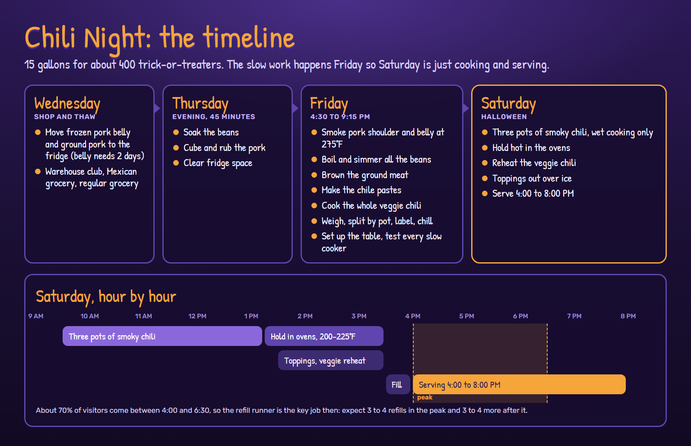

# Chili Night 2026

Real food, made from scratch. Happy Halloween! The menu below is the text of
[poster 2](../posters/2%20Chili%20Night%20Menu.pdf). ([Back to the night](../README.md))

## The menu

**1. Pick your chili**

- **Smoky Chili** (mild-medium): smoked pork shoulder, smoky pork belly bites, beef and
  pork, pinto and kidney beans, a whole-chile sauce.
- **Mild Veggie Chili** (mild, vegan): black and pinto beans, roasted sweet potato, corn
  and mild chiles. No meat, no dairy.

**2. Pick how you want it**

| | What it is | Smoky | Veggie |
| --- | --- | --- | --- |
| Chili Cup | A hot cup of chili, straight up (5 fl oz) | 180 cal | 120 cal |
| Chili & Chips | Crunchy corn chips under your choice of chili | 300 cal | 260 cal |
| Chili Mac | Elbow macaroni topped with your choice of chili | 190 cal | 150 cal |

**3. Pile on the toppings:** diced white onion, shredded mild cheddar, sour cream, and
five hot sauces. The one marked HOT means it.

**Taking it to go?** Just ask for a lidded cup.

*2,000 calories a day is used for general nutrition advice, but calorie needs vary. Toppings
are not included in the calories.*

Full ingredients, nutrition and allergens: [what's in the chili](ingredients-and-nutrition.md)
(also [poster 3](../posters/3%20Chili%20Ingredients%20and%20Nutrition.pdf)). Ours is a home
kitchen and isn't allergen-free; if you have a food allergy, ask us and we'll show you the
labels.

## Cooking for 400

15 gallons in all: 12 of smoky chili (three 4-gallon pots) and 3 of veggie. That's about 385
cups at 5 fl oz, since not every trick-or-treater takes food. The slow work (smoking, beans,
chile paste, the whole veggie chili) happens Friday night, so Saturday is just cooking and
serving.

- [The recipes](recipes.md): smoky chili and mild veggie chili, as made for 400
- [The timeline](timeline.md): Wednesday to Saturday, hour by hour
- [Food safety and the serving table](safety-and-setup.md): holding temperatures, cooling,
  table layout, power
- [Shopping list](shopping-list.md): everything, by aisle

It's all a gift to the neighborhood, so there are no prices here.
