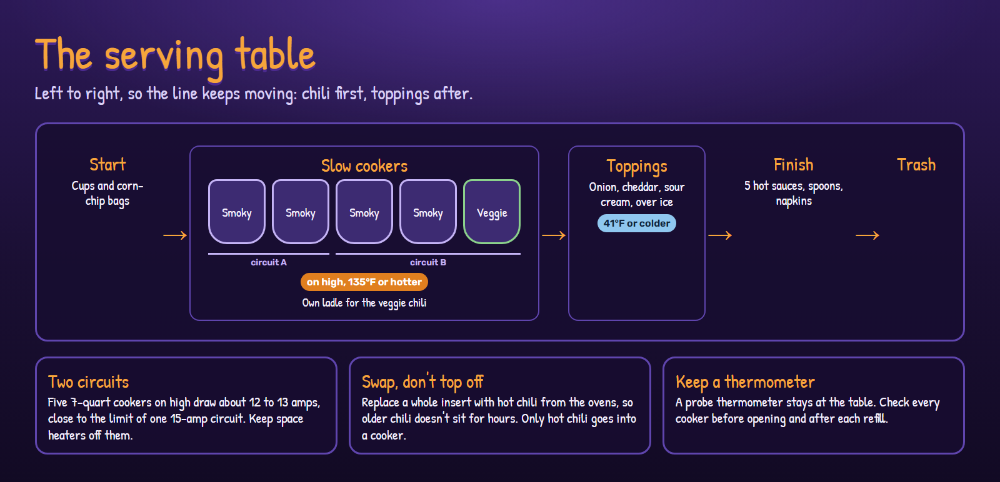

# Food safety and the serving table

The biggest risks are scorching while holding, chili dropping below a safe temperature in a
cold garage, and the line backing up at the toppings.
([Back to the food page](README.md))

## Table layout

Left to right: cups and corn-chip bags, then the slow cookers (smoky, smoky, smoky, smoky,
veggie), then toppings over ice, then hot sauces, spoons and napkins, then the trash can.
Toppings come after the chili so people keep moving instead of waiting at the ladle.

## Safety

- Kidney beans must boil hard for 10 minutes. Never cook raw or soaked kidney beans straight
  in a slow cooker.
- Cool Friday's beans and all cooked meat in shallow, uncovered pans: to 70°F within 2 hours
  and to 41°F within 4 more. Don't put a full, hot stockpot in the fridge.
- Hot holding at 135°F or above: slow cookers on high, lids on between scoops. Keep a probe
  thermometer at the table.
- Only put hot chili into a slow cooker, never cold.
- Toppings at 41°F or below: cheese, onion and sour cream over ice. Swap in fresh pans
  halfway through.
- Don't top off a cooker. Swap the whole insert so older chili doesn't sit for hours.

## Kitchen

- Big pots scorch. Use the lowest flame or a heat diffuser, stir every 15 to 20 minutes, and
  don't scrape stuck bits up from the bottom.
- Test that three 20-quart pots fit on the range on Friday. If they don't, run one on a
  propane burner.
- Use a separate ladle for the veggie chili.
- Taste for salt last. Beans and masa absorb it.

## Garage and service

- Five 7-quart slow cookers on high draw about 12 to 13 amps, close to the limit of one
  15-amp circuit. Split them across two circuits and keep space heaters off those circuits.
- Each 7-quart cooker holds about 6 usable quarts, or about 38 servings.
- Tape down extension cords, and put a light over the table.
- Signs: which chili is which, what Chili & Chips is (with a sample bag), and the allergens.
- Tear the chip bags along the long side, or pre-tear a stack.
- Give the inside runner a timer or a text cue for refills.
- Plan for 2 to 3 gallons of leftovers, with freezer bags or quart containers ready.
