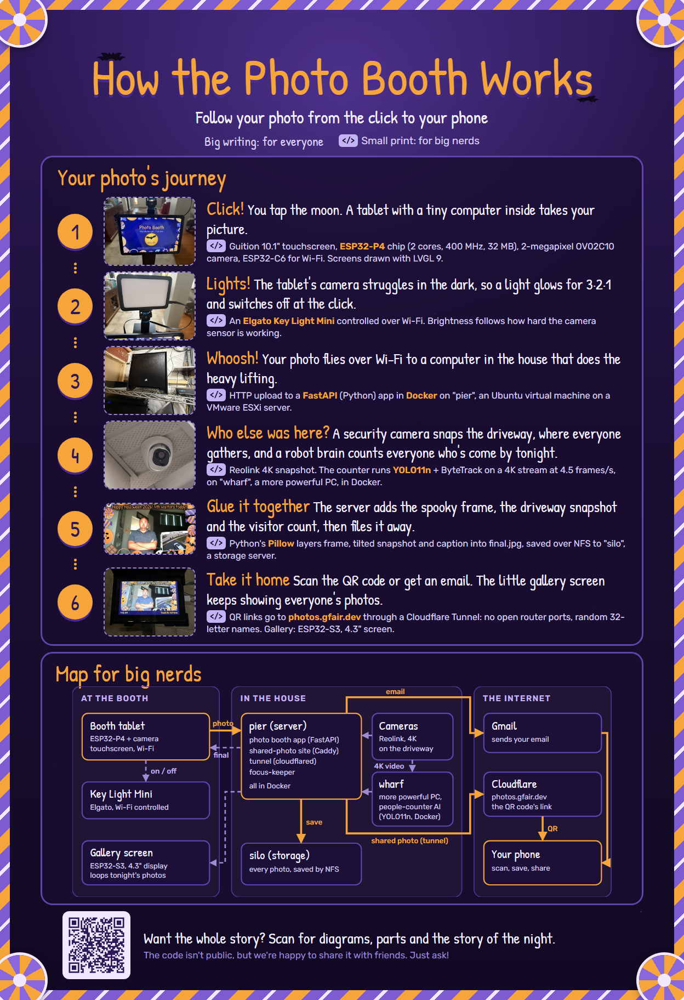
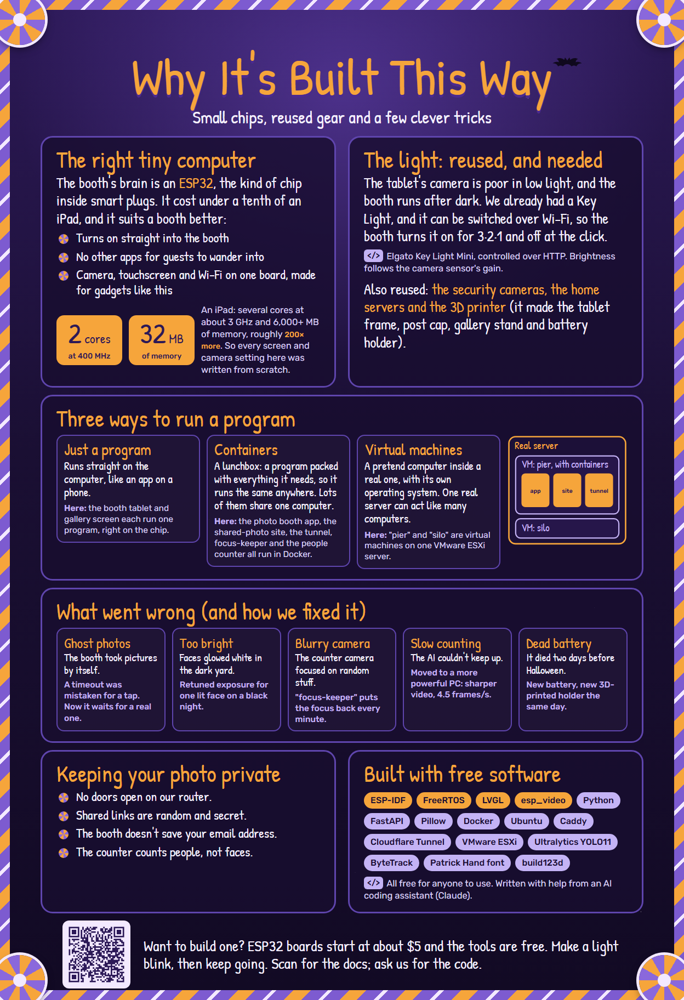
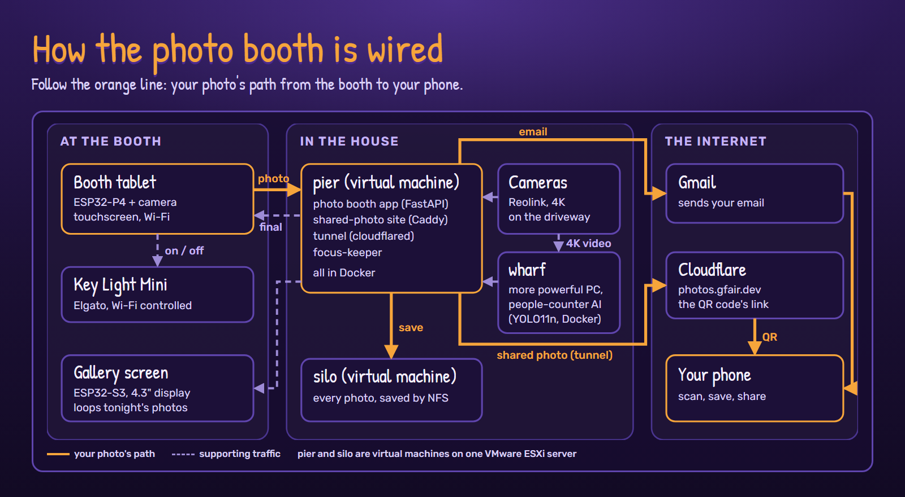

# Our Halloween Photo Booth

A homemade photo booth for Halloween night: tap the glowing moon, smile for 3·2·1, and take
your photo home by QR code or email. A little gallery screen loops everyone's photos, and
every photo carries a surprise: a snapshot of the driveway at that moment and a count of
how many people had come by.

New here? Start with [how to use it](how-to-use.md). This page is the long version of the
two "nerd signs" at the booth, and the [deep dive](#the-deep-dive) goes further.
([Back to the whole night](../README.md))

| How it works | Why it's built this way |
| --- | --- |
|  |  |

## Your photo's journey

1. **Click!** You tap the moon. A tablet with a tiny computer inside starts the countdown.
2. **Lights!** The tablet's camera struggles in the dark, so a light comes on for 3·2·1 and
   switches off at the click.
3. **Whoosh!** The photo goes over Wi-Fi to a server in the house.
4. **Who else was here?** At the same moment the server grabs a snapshot from a security
   camera aimed at the driveway, where everyone gathers, and asks the people counter how
   many people have come by tonight.
5. **Glue it together.** The server adds the frame, the tilted driveway snapshot and the
   visitor count, and saves the finished photo.
6. **Take it home.** The tablet shows the finished photo. Scan its QR code to save it on
   your phone, or type your email address and it's sent to you.

## The map

## The deep dive

For the nerds: every chip, message, layer and threshold, with diagrams drawn from the real
code and real measurements.

| | |
| --- | --- |
| [The booth tablet](deep-dive/tablet.md) | ESP32-P4 camera pipeline, camera tuning for a dark driveway, light control, the screens, FreeRTOS tasks, the gallery screen, bugs worth telling |
| [One photo, start to finish](deep-dive/one-photo.md) | every message with its timeout, the backend API, how the finished photo's layers are built, what's saved, email, what happens when something is down |
| [The people counter](deep-dive/people-counter.md) | camera stream → YOLO11n → ByteTrack, counting someone once, the benchmark surprise, what it stores, honest limits |
| [focus-keeper](deep-dive/focus-keeper.md) | the control loop, the Laplacian sharpness score, the sweep, real day and night data |
| [Where everything runs](deep-dive/where-it-runs.md) | VMs vs containers, the two ways in from the internet (shared photos and the owner's gallery), privacy precisely |

## The parts

| Part | What it is | Job |
| --- | --- | --- |
| Booth tablet | Guition JC8012P4A1C: 10.1" touchscreen, ESP32-P4 (2 RISC-V cores at 400 MHz, 32 MB PSRAM, 16 MB flash), ESP32-C6 for Wi-Fi, OV02C10 2-megapixel camera | Start screen, countdown, photo, review, QR code, email keyboard |
| Light | Elgato Key Light Mini | Lights the guests; switched over Wi-Fi |
| Gallery screen | Waveshare ESP32-S3-Touch-LCD-4.3 (800 x 480) | Loops tonight's photos; tap for a photo's QR code |
| Driveway camera | Reolink RLC-820A, 4K | The snapshot in every photo |
| Counter camera | Reolink 4K camera on an NVR | Video for the people counter |
| pier | Ubuntu virtual machine on a VMware ESXi server | Runs the booth app, the people counter and friends in Docker |
| silo | Ubuntu virtual machine on the same ESXi server | Stores every photo (NFS) |
| wharf | A more powerful PC (Intel i5-12400), Ubuntu, Docker | Ran the people counter for the 2026 event |
| 3D prints | Designed in build123d (Python) | Tablet frame, post cap, gallery stand, battery holder |
| Power | Anker 25K power bank | Runs the tablet all night |

## Why it's built this way

### The right tiny computer

The booth's brain is an ESP32, the kind of chip inside smart plugs and light bulbs. It cost
under a tenth of an iPad, but cost isn't the main reason. It suits a booth:

- It turns on straight into the booth, with no unlocking, updates or notifications.
- There are no other apps for guests to wander into.
- Camera, touchscreen and Wi-Fi come on one board made for gadgets like this.

The trade-off is power: **2 cores at 400 MHz and 32 MB of memory**. A current iPad has
several cores at about 3 GHz and 6,000+ MB, roughly 200 times the memory. So every screen,
button and camera setting was written from scratch, and anything heavy is handed to a
server. One uncompressed 4K video frame is about 24 MB on its own.

### The light: reused, and needed

The tablet's camera is poor in low light, and the booth runs after dark. We already had an
Elgato Key Light Mini, and it can be controlled over the network, so the booth turns it on
for the countdown and off at the click. During the countdown it sets the brightness from
how hard the camera sensor is working.

Other things reused rather than bought: the security cameras, the home servers and the 3D
printer.

### Small brain, big brains

The tablet does what it's good at: screens, countdown, taking the picture, drawing the QR
code. The servers build the finished photo, send email, store everything and run the
people-counting AI, which needs gigabytes of memory.

### Three ways to run a program

- **Just a program.** It runs straight on the computer, like an app on a phone. The tablet
  and the gallery screen each run one program, right on the chip (firmware, built with
  ESP-IDF on FreeRTOS).
- **Containers.** A lunchbox: a program packed with everything it needs, so it runs the same
  anywhere, and lots of them can share one computer. The booth app, the shared-photo site,
  the tunnel, focus-keeper and the people counter all run in Docker containers.
- **Virtual machines.** A pretend computer inside a real one, with its own operating system,
  so one real server can act like many computers. pier and silo are virtual machines on one
  VMware ESXi server.

## What went wrong (and how we fixed it)

- **Ghost photos.** The booth sometimes took pictures by itself. A "nothing happened"
  timeout was being read as a tap on Start. Now it waits for a real tap.
- **Too bright at night.** Faces lit by the Key Light came out white against the black yard.
  The camera's automatic exposure was retuned for one bright face on a dark night.
- **Blurry counter camera.** Its autofocus wandered onto random things and stayed there, and
  the recorder can't switch autofocus off. A small service, focus-keeper, checks the focus
  every minute and puts it back to the sharpest position, found by sweeping the lens and
  scoring the picture's sharpness.
- **Slow counting.** On pier the people counter could only look at a small,
  low-resolution stream. For the 2026 event it ran on wharf, a more powerful PC, and watched
  the full 4K stream at 4.5 frames a second. (Using one thread per physical CPU core, not
  two, made it three times faster.) Afterwards it moved back to pier and the low-resolution
  stream, to free up wharf.
- **Dead battery.** The power bank died two days before Halloween. A new one was ordered and
  a new holder was designed and 3D-printed the same day, with windows so its ports can be
  reached.

## Keeping your photo private

- No doors are open on our router. Shared photos leave through an outbound Cloudflare
  Tunnel.
- Each shared photo gets a random 32-character name, and nothing lists them, so only someone
  with the exact link can see it.
- The booth doesn't save your email address. (The account that sends it keeps the sent
  message, like any sent mail.)
- The people counter counts people, not faces. It keeps a small picture of each person on
  our home network for its dashboard, deleted after 30 days.
- The start screen tells guests that photos are saved and that a second camera is in use.

The details are in [where everything runs](deep-dive/where-it-runs.md#privacy-precisely).

## Built with free software

ESP-IDF, FreeRTOS, LVGL 9, esp_video, Python, FastAPI, Pillow, Docker, Ubuntu, Caddy,
Cloudflare Tunnel, VMware ESXi, Ultralytics YOLO11, ByteTrack, OpenCV, the Patrick Hand
font, and build123d for the 3D parts.

## Who wrote all this?

**Claude**, an AI coding assistant, wrote **7,075 lines of code** to make this Halloween
special, working alongside us over three weeks in October. That's about 18 lines for every
trick-or-treater we're expecting, or roughly 130 printed pages.

| Part | Lines |
| --- | ---: |
| Booth tablet firmware (C, ESP-IDF) | 2,050 |
| People counter (Python, YOLO11n) | 961 |
| Photo booth backend: API, compositor, email (Python) | 798 |
| Repo infographics and the script that draws them | 711 |
| Signs, posters and the architecture page (HTML) | 675 |
| 3D-printed mounts (Python, build123d) | 646 |
| Gallery screen firmware (C) | 633 |
| Camera-tuning and test scripts, start-screen art | 345 |
| focus-keeper (Python) | 256 |
| **Total** | **7,075** |

Non-blank lines written for this project, as of October 30, 2026. Not counted: the
open-source libraries it stands on, Espressif's drivers (including the touch-driver bugs we
fixed in them), and the camera's tuning file.

## Want to build one?

ESP32 boards start at about $5 and the tools are free. Start by making a light blink, then
keep going. The booth's code isn't public, but friends are welcome to ask us for it.
