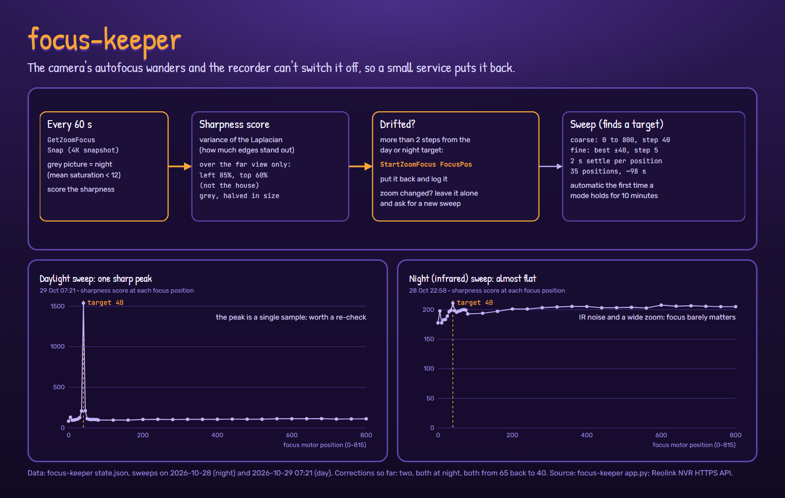

# Deep dive: focus-keeper

The driveway camera that feeds the people counter has a motorised zoom and focus. Its
autofocus would wander onto something nearby and stay there, blurring the driveway, and the
recorder it's attached to doesn't allow autofocus to be switched off. So a small service on
pier checks the focus every minute and puts it back.
([Back to the deep dive](README.md))

## The loop

Every 60 seconds, through the recorder's HTTPS API:

1. `GetZoomFocus` (current focus and zoom) and `Snap` (a 4K snapshot).
2. **Day or night?** The snapshot is shrunk to 320×180; a mean HSV saturation below 12 means
   the camera has switched to infrared (a grey picture).
3. **Drifted?** If focus is more than 2 steps from that mode's target, `StartZoomFocus` with
   `op: FocusPos` puts it back, and the correction is logged.
4. **Zoom changed?** If someone zoomed the camera since the target was found, the old target
   is wrong, so it leaves the focus alone and asks for a new sweep.

## Finding a target: the sweep

The sharpness score is the **variance of the Laplacian**: run an edge-detecting kernel over
a greyscale image and measure how spread out the result is. Sharp images have strong edges,
so high variance. It's scored only over the far part of the view (left 85%, top 60%), which
leaves out the house itself, and on a half-size copy.

- **Coarse:** focus 0 to 800 in steps of 40.
- **Fine:** the best coarse position ± 40, in steps of 5.
- Each position waits 2 s for the motor and the picture to settle: 35 positions, about 98 s.
- A mode with no target is swept automatically once it has held for 10 minutes; the status
  page also has a Sweep button.

## Real data

| | Day | Night |
| --- | --- | --- |
| Swept | 29 Oct, 07:21 | 28 Oct, 22:58 |
| Target | 40 | 40 |
| Best score | 1537 | 211 |
| Typical score elsewhere | about 100 | about 200 |

- **Night is nearly flat** (178 to 211 across the whole range). In infrared at the widest
  zoom, noise dominates and almost everything is in focus anyway, so the target hardly
  matters.
- **Day has one sharp peak.** Positions 35 and 45 score about twice the background and
  position 40 scores 15 times. A peak that narrow, from a single sample, deserves a second
  look (a passing car or a change in light during that one snapshot could inflate it), so
  we'll run another daylight sweep to confirm it. The neighbours agree on 40 either way.
- So far it has made two corrections, both at night, both from 65 back to 40.

## Service

Python with Pillow and NumPy in a `python:3.12-slim` container; a status page and
`/api/status` on the home network; `POST /api/sweep` to start a sweep (409 if one is already
running). State (targets, sweep curves, the last 200 events) lives in `state.json`.
