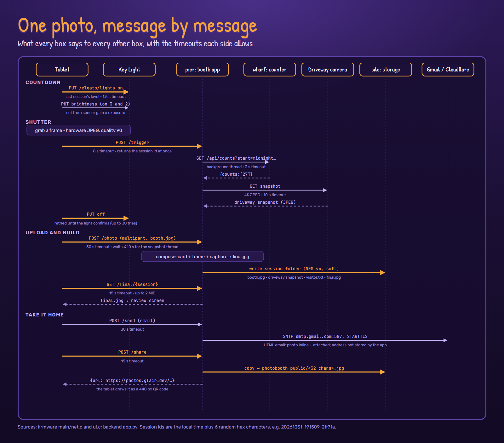
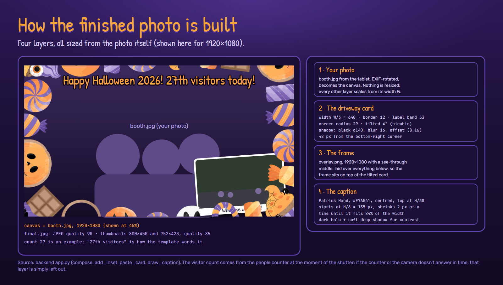

# Deep dive: one photo, start to finish

Every message between the tablet, the light, the servers and the internet, and how the
finished photo is put together.
([Back to the deep dive](README.md))

## The backend's API

The booth app is a single Python file (FastAPI, one process; endpoints run in its
threadpool) in a `python:3.12-slim` container on pier. Port 8000 is reachable only on the
home network and has no login.

| Endpoint | Called by | What it does |
| --- | --- | --- |
| `POST /trigger` | tablet, at the shutter | creates the session folder and returns its id at once; a background thread asks the people counter for today's count (3 s timeout) and grabs the driveway camera snapshot (10 s) |
| `POST /photo` | tablet | uploads `booth.jpg`, waits up to 10 s for that thread, builds `final.jpg` |
| `GET /final/{id}` | tablet, phones | the finished photo |
| `POST /send` | tablet | emails it |
| `POST /share` | tablet, gallery | publishes a copy under a random name and returns its link |
| `POST /light` | (setup) | switches the Key Light; the tablet normally talks to the light directly |
| `GET /today` | gallery | today's sessions, with times |
| `GET /thumb/{id}?size=` | gallery, phones | 800×450 or 752×423 thumbnails, made on demand |
| `GET /photos` | phones on the home Wi-Fi | a grid of today's photos |
| `GET /status` | the photos page | health of the booth, gallery and storage |

Session ids are the local time plus 6 random hex characters: `20261031-191509-2ff71a`.

## Building the finished photo

Everything is measured from the photo's own width W and height H, so it would work at any
resolution. For a 1920×1080 photo:

| Layer | Detail |
| --- | --- |
| 1. Your photo | `booth.jpg`, rotated by its EXIF tag; this is the canvas |
| 2. Driveway card | W/3 = 640 px wide; white border 12 px; label band 53 px reading "Who else was here?"; corner radius 29; rotated 4° anticlockwise (bicubic); drop shadow black at α 140, blur 16, offset (8, 16); 48 px from the bottom-right corner |
| 3. The frame | `overlay.png`, the Halloween artwork, 1920×1080 with a transparent middle; it goes over the card, so the candy overlaps it |
| 4. Caption | "Happy Halloween 2026!" plus "27th visitors today!" (the count from the people counter, as an ordinal); Patrick Hand in #F7A541, centred, top at H/30; starts at H/8 and shrinks 2 px at a time until it fits 84% of the width; a dark halo (stroke size/6, blur size/7) and a soft drop shadow keep it readable on any photo |

`final.jpg` is saved at JPEG quality 90. Thumbnails use LANCZOS at quality 85.

If the counter doesn't answer in 3 s there's no caption; if the camera doesn't answer in
10 s there's no card. The photo still comes out.

## What's saved

Each session is a folder on silo, over NFS v4:

| File | What |
| --- | --- |
| `booth.jpg` | the tablet's photo |
| (driveway snapshot) | the 4K camera's still, as the camera sent it |
| `visitor.txt` | the count at the shutter |
| `final.jpg` | the finished photo |
| `thumb.jpg`, `thumb-gallery.jpg` | thumbnails |
| `public.txt` | the shared name, once shared |

Shared copies go to a separate `photobooth-public/` folder under a name from
`secrets.token_urlsafe(24)`: 32 URL-safe characters, 192 random bits. Sharing the same photo
again reuses its name.

The share is mounted "soft" (`soft,timeo=100,retrans=2`), so if silo is down a save fails
after about 30 seconds and the tablet offers "Try again", instead of everything hanging.

## Email

`smtp.gmail.com:587` with STARTTLS. The message is `multipart/mixed`: a
`multipart/alternative` (plain text, and HTML with the photo inline by `cid`, with save
instructions for iPhone and Gmail) plus the photo as an attachment. The app doesn't store
the address or log it; the sending account keeps a copy in its sent mail, as any email does.

## When something is down

| Down | What guests see |
| --- | --- |
| silo (storage) | "Try again" after about 30 s |
| Driveway camera | the photo, without the card |
| People counter | the photo, without the caption |
| Key Light | the booth carries on, darker |
| Internet or tunnel | email and QR fail; photos still save and show on the gallery |
| Email templates | a plain one-line email instead |
