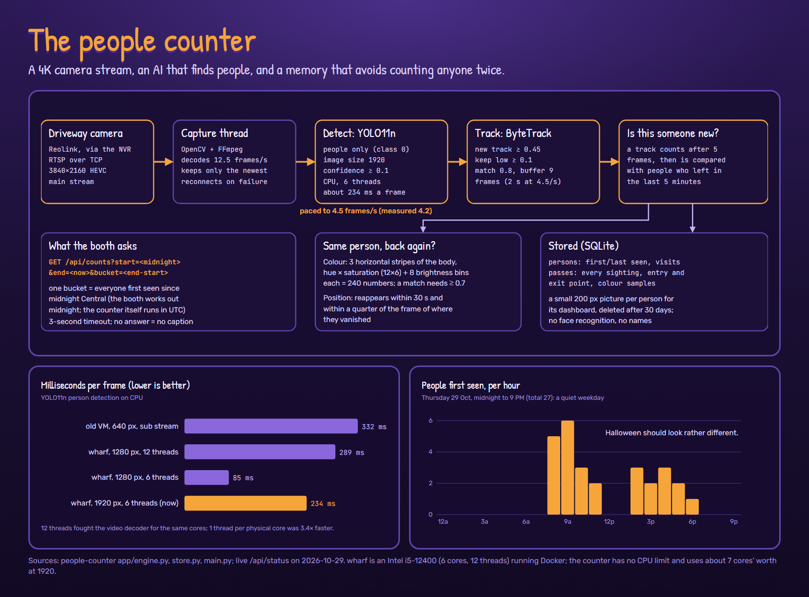

# Deep dive: the people counter

The "27th visitors today!" on your photo comes from a separate service that watches the
driveway camera's low-resolution preview stream and counts the people it sees, trying hard
not to count anyone twice. It runs in Docker on pier, the small always-on server. For the
2026 event it ran on wharf, a more powerful PC, on the full 4K stream (see
[Performance](#performance)).
([Back to the deep dive](README.md))



## Pipeline

| Stage | Detail |
| --- | --- |
| Stream | the camera's preview sub-stream via the recorder: 640×360 over RTSP, forced to TCP |
| Capture | OpenCV with FFmpeg in its own thread; keeps only the newest frame, so detection never falls behind; reconnects on failure (10 s timeouts) |
| Detect | Ultralytics **YOLO11n**, people only (class 0), confidence ≥ 0.1, image size 640, on the CPU with PyTorch set to 3 threads |
| Track | **ByteTrack**: a new track needs confidence ≥ 0.45, existing tracks keep low-confidence matches ≥ 0.1, match threshold 0.8, a 9-frame buffer (2 s at 4.5 frames/s); a track closes after 2 s unseen |
| Rate | aims for 4.5 frames/s; gets about 3.6, limited by detection at about 332 ms a frame |

## Counting someone once

A track only counts once it has been seen in 5 analysed frames. Then it is compared with
people who left in the last 5 minutes:

- **By colour.** The body is cut into 3 horizontal stripes; each gets a hue × saturation
  histogram (12 × 6) plus 8 brightness bins, 240 numbers in all. Up to 12 samples are kept per
  pass. A histogram intersection of 0.7 or more is a match.
- **By position.** Someone who reappears within 30 s, within a quarter of the frame of where
  a track vanished, is the same person (someone stepping behind a pillar).

A match is recorded as another visit by the same person; otherwise a new person is added.

## The booth's question

```
GET /api/counts?start=<local midnight>&end=<now>&bucket=<end - start>
→ {"start": …, "bucket": …, "counts": [27]}
```

One bucket covering midnight to now gives everyone first seen today. The booth works out
midnight in Central time; the counter itself runs in UTC and doesn't need to know.

Other endpoints: `/api/status` (rates, timings, in-frame count, last hour, last 24 h, all
time), `/api/people`, `/api/config`, `/snapshot.jpg`, `/stream.mjpg`, and a dashboard with
a live view and a bar chart.

## Performance

The counter runs on pier, a 4-vCPU virtual machine, which can only afford the camera's
640×360 sub-stream: 332 ms a frame, using about 2.7 of its 4 cores. For the 2026 event it ran
on wharf, a more powerful PC (Intel i5-12400, 6 cores, 12 threads), on the full 4K stream.
That move turned up a surprise:

| Setup | ms per frame |
| --- | ---: |
| pier, 640 px, sub-stream (now) | 332 |
| wharf, 1280 px, 12 threads | 289 |
| wharf, 1280 px, 6 threads | 85 |
| wharf, 1920 px, 6 threads (2026 event, measured) | 234 |

With 12 PyTorch threads on a 6-core CPU, the threads fought each other and the HEVC decoder
for the same cores. One thread per physical core was 3.4 times faster. At 1920 it used about
7 cores' worth of CPU and under 1 GB of memory, with no limits set.

**A design choice.** After the event the counter moved back to pier and the sub-stream on
purpose. The counter is only needed during events; pier's version is good enough for the
booth's caption; and it leaves wharf, the more powerful PC, free for its other work. The 4K
settings are kept, so it can move back to wharf for an event that needs them.

## What it stores

SQLite, in WAL mode:

- `persons`: id, first seen, last seen, visits.
- `passes`: every sighting with its entry and exit points, hit count and colour samples.
- A 200 px-tall thumbnail per person, for its dashboard on the home network. Thumbnails are
  deleted after 30 days.

It detects that a person is there; it doesn't recognise faces or know names.

## Honest limits

- Colour matching can't tell apart two people in similar clothes who pass within 5 minutes,
  so the count can run a little low in a busy crowd; and someone who comes back after more
  than 5 minutes is counted again.
- A few very long passes (one lasted 53 minutes) suggest that something static near the top
  of the frame is now and then detected as a person. They count once each, so the effect on
  the total is small.
