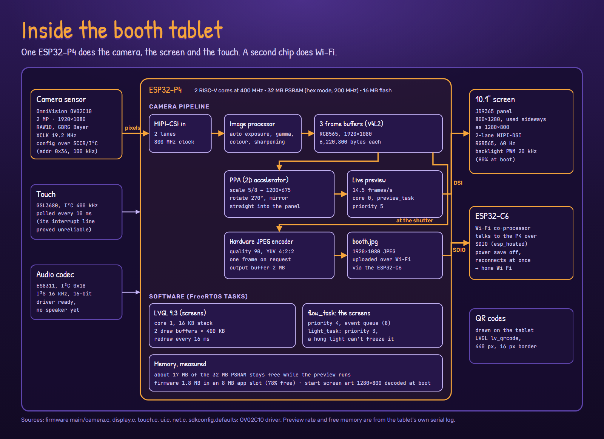
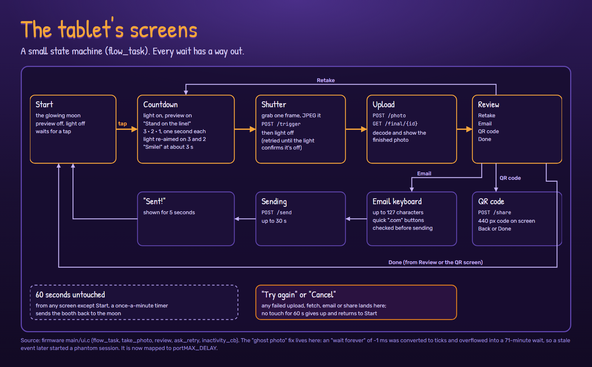

# Deep dive: the booth tablet

The booth is a Guition JC8012P4A1C: a 10.1" touchscreen built around Espressif's ESP32-P4,
with an ESP32-C6 alongside it for Wi-Fi. All of its software was written for this booth with
ESP-IDF 5.5.5 (FreeRTOS) and LVGL 9.3.
([Back to the deep dive](README.md))

## Hardware

| Part | Detail |
| --- | --- |
| Main chip | ESP32-P4, 2 RISC-V cores at 400 MHz, 32 MB PSRAM (hex mode, 200 MHz), 16 MB flash. This unit is chip revision 3.2, which needs ESP-IDF 5.5.x: 5.4 reset-loops in the bootloader. |
| Camera | OmniVision OV02C10, 2 MP, 1920×1080 RAW10 (GBRG Bayer) over 2-lane MIPI-CSI at 800 MHz; 19.2 MHz clock from an LEDC timer; configured over SCCB at 0x36 |
| Screen | JD9365 panel, 800×1280 portrait, driven sideways as 1280×800 over 2-lane MIPI-DSI, RGB565, 60 Hz. Backlight PWM 20 kHz |
| Touch | GSL3680 at I²C 0x40, 400 kHz, polled every 10 ms, up to 5 points |
| Wi-Fi | ESP32-C6 co-processor over SDIO (esp_hosted); power saving off, reconnects immediately |
| Audio | ES8311 codec at I²C 0x18, I²S 16 kHz. The driver works; the board is still waiting for a speaker |

## Camera pipeline

1. The sensor streams RAW10 into the P4's MIPI-CSI receiver.
2. The image signal processor (via Espressif's `esp_video`) does demosaicing, auto-exposure,
   gamma, colour correction and sharpening, and delivers RGB565 frames to three V4L2 buffers
   (6,220,800 bytes each).
3. **Preview:** the PPA (the P4's 2D accelerator) scales each frame by 5/8 to 1200×675,
   rotates it 270° and mirrors it, writing straight into the screen's framebuffer. Measured:
   14.5 frames a second, on core 0.
4. **Capture:** at the shutter one frame goes to the P4's hardware JPEG encoder (quality 90,
   YUV 4:2:2) and becomes `booth.jpg`, 1920×1080.

About 17 MB of the 32 MB PSRAM stays free while the preview runs. The firmware is 1.8 MB in
an 8 MB app slot.

## Tuning the camera for a dark driveway

The booth runs after dark with one light on the guests. The stock exposure settings tried to
brighten the whole black frame, so faces came out white (23 to 50% of the face clipped). The
fix is in the camera's tuning file (`ov02c10_default.json`):

| Setting | Value | Why |
| --- | --- | --- |
| Auto-exposure mode | `light_threshold_priority` | weight the bright parts (the lit faces), not the dark yard |
| Bands (brightness → extra weight) | 0 → +0, 12 → +4, 40 → +16, 80 → +40, 140 → +90, 200 → +160 | steep, so a lit face dominates the exposure |
| Brightness target | 84 (range 76 to 92) | |
| Gamma | 0.72, 16-point curve | lifts the mid-tones |
| White balance | fixed: red 1.735, blue 1.469 | automatic white balance assumes the scene averages to grey; a frame full of faces doesn't. Calibrated at 4500 K against white paper |
| Lens shading | flat (all 1.0) | |

The light itself is part of the exposure plan: holding the guests at a steady brightness
means the camera never needs a slow shutter or high gain, which would blur and add grain.

## How the tablet drives the light

The light is an Elgato Key Light Mini, controlled over HTTP:
`PUT /elgato/lights` with `{"numberOfLights":1,"lights":[{"on","brightness","temperature"}]}`.
Colour temperature is sent in mireds (1,000,000 ÷ kelvin, 143 to 344).

- **On** at the start of the countdown, at the last session's level.
- **Aimed** on "3" and on "2": the tablet reads the sensor's exposure and gain registers,
  computes how hard the camera is working (exposure ÷ 2328 lines × analogue gain × digital
  gain), and sets `level × (amplification ÷ 4)^0.7`, clamped to the configured range. It only
  changes if the step is at least 3 points and 10%.
- **Off** at the shutter. Off is the command that matters (a light left on all night is
  noticed), so it is retried up to 30 times until the light confirms, in its own task so a
  hung light can never freeze the screens.

## The screens

| Screen | What happens | Timing |
| --- | --- | --- |
| Start | the moon; preview and light off | waits for a tap |
| Countdown | "Stand on the line!", then 3 · 2 · 1 | 1 s each (700 ms settle), "Smile!" at about 3 s |
| Shutter | capture, `POST /trigger`, light off | |
| Upload | `POST /photo`, `GET /final/{id}`, decode | timeouts 30 s and 15 s |
| Review | Retake, Email, QR code, Done | |
| Email | on-screen keyboard, up to 127 characters, quick ".com" buttons | `POST /send`, 30 s; "Sent!" shows 5 s |
| QR code | `POST /share`, a 440 px QR code drawn on the tablet | 15 s |
| Try again / Cancel | any failed network step | gives up after 60 s untouched |

From any screen but Start, 60 seconds without a touch returns to the moon.

## Tasks

| Task | Core | Priority | Job |
| --- | --- | --- | --- |
| LVGL port | 1 | (library) | draws the screens; two 400 KB draw buffers in PSRAM; redraw every 16 ms |
| preview_task | 0 | 5 | preview frames, JPEG on request, brightness readout |
| flow_task | any | 4 | the state machine above; event queue of 8 |
| light_task | any | 3 | light commands; a one-slot queue that always holds the newest command |
| console_task | any | 3 | serial keys for testing (`s` starts a session) |

## The gallery screen

A Waveshare ESP32-S3 with a 4.3" 800×480 screen. Every 60 s it asks for `GET /today`, then
shows each photo for 3.5 s from `GET /thumb/{id}?size=gallery` (752×423 JPEGs, decoded in
software; the S3 has no JPEG hardware). The backlight goes off for each swap so you never see
a half-drawn picture. Tap it and it fetches `POST /share` and shows a 280 px QR code for 60 s.

## Bugs worth telling

- **Ghost photos.** "Wait forever" was passed as −1 milliseconds and converted to ticks,
  which overflowed into a 71-minute wait. When it ran out, a stale event looked like a tap on
  Start. Now "forever" is mapped to `portMAX_DELAY`.
- **Touch.** A failed touch read was parsed as a touch; the read buffer was 24 bytes for a
  44-byte reply (a stack overflow); flag bits leaked into the Y coordinate; and the touch
  interrupt line was unreliable, so the driver now polls.
- **The display PHY** clock source has to be 0 on this chip revision.
