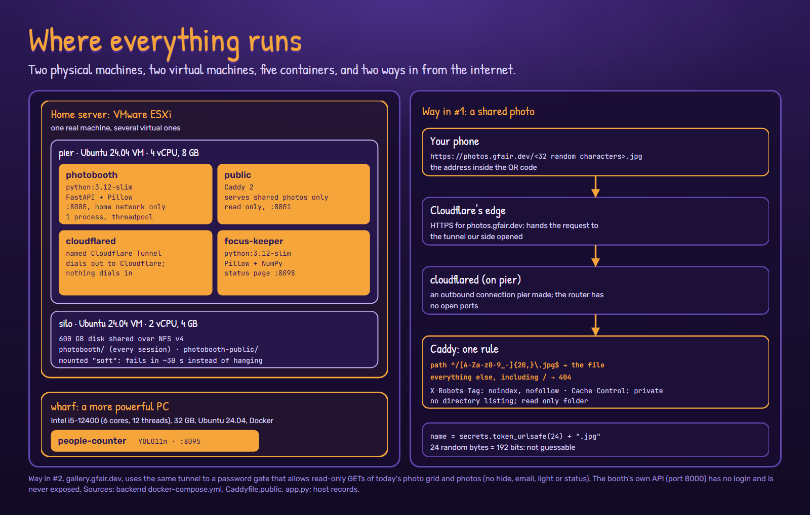

# Deep dive: where everything runs

Two physical machines, two virtual machines, five containers, and two ways in from the
internet: shared photos for guests, and a password-protected gallery for us.
([Back to the deep dive](README.md))

## The machines

| Machine | What it is | Runs |
| --- | --- | --- |
| Home server | VMware ESXi | the two virtual machines below |
| pier | Ubuntu 24.04 VM, 4 vCPU, 8 GB | Docker: the booth app, the shared-photo site, the tunnel, focus-keeper, the people counter |
| silo | Ubuntu 24.04 VM, 2 vCPU, 4 GB, 600 GB data disk | NFS v4 shares for every session and for shared photos |
| wharf | a more powerful PC: Intel i5-12400 (6 cores, 12 threads), 32 GB, Ubuntu 24.04 | ran the people counter for the 2026 event (it's back on pier now) |

**Why virtual machines?** One physical server can be several independent computers, each
with its own operating system, sized for its job and easy to snapshot before a change.
**Why containers?** Each service brings exactly the software it needs, so they don't
interfere, and `docker compose up -d --build` rebuilds any one of them the same way every
time.

## The containers

| Container | Image | Port | Job |
| --- | --- | --- | --- |
| photobooth | python:3.12-slim + FastAPI, Pillow, requests | 8000, home network only | the booth's API and the compositor |
| public | Caddy 2 | 8001 | serves shared photos, read-only |
| cloudflared | cloudflare/cloudflared | none | the outbound tunnel to Cloudflare |
| focus-keeper | python:3.12-slim + Pillow, NumPy | 8098 | keeps the camera in focus |
| people-counter | python:3.12-slim + Ultralytics, PyTorch (CPU) | 8095 | counts visitors |

All of them restart automatically (`restart: unless-stopped`).

## Way in #1: a shared photo

A shared photo's link looks like `https://photos.gfair.dev/<32 random characters>.jpg`.

1. **Cloudflare's edge** answers for photos.gfair.dev over HTTPS.
2. It passes the request down a **Cloudflare Tunnel**: a connection that `cloudflared` on
   pier opened *outwards*. Nothing on the internet can open a connection to the house, and
   the router has no ports forwarded.
3. **Caddy** has a single rule. Only a path matching `^/[A-Za-z0-9_-]{20,}\.jpg$` returns a
   file; everything else, including `/`, is a 404. Responses carry
   `X-Robots-Tag: noindex, nofollow` and `Cache-Control: private`, and there's no directory
   listing.
4. The names come from `secrets.token_urlsafe(24)`: 192 random bits, so they can't be
   guessed or enumerated.

## Way in #2: the owner's gallery

`https://gallery.gfair.dev` comes in through the same tunnel to a second, separate Caddy
gate. It's how we look after the night from a phone, anywhere:

- **Helping someone get their photo.** If a guest's QR scan or email didn't work, we find
  their photo in today's grid, open it full size, and share it from the phone.
- **Keeping an eye on the gallery screen.** It's the same list the self-service gallery
  screen loops, so an accidentally offensive photo is easy to spot. Removing one is done
  with the Hide button on the photos page on the home network: it moves the session to an
  archive (nothing is deleted), so it drops off the gallery screen and the grid.

How the gate works:

- One shared password, no username. The login page stores it in a cookie; Caddy compares
  the cookie with the password from its environment. It's deliberately simple: it keeps the
  photos off the open internet, but it isn't real authentication.
- Once in, only `GET` and `HEAD` on `/photos`, `/today`, `/thumb/*`, `/final/*` and the
  font are passed to the booth app, with the cookie stripped and an `X-Gallery-Public: 1`
  header. The app then serves its photos page without the status bar and Hide buttons.
- Everything else (the camera, email, the light, hiding, status) is a 404, and every
  response carries `X-Robots-Tag: noindex, nofollow` and `Referrer-Policy: no-referrer`.

The booth's own API (port 8000) has no login, so it is never exposed directly; only these
two gates are. That includes the photos page for phones on the home Wi-Fi, with its Hide
buttons.

## Privacy, precisely

- Photos are kept on our own storage (silo). Shared copies can only be reached with their
  exact link.
- Today's photos can also be browsed at gallery.gfair.dev, behind our password, so we can
  help guests get their photo and keep the gallery screen tidy.
- The app never saves your email address. The account that sends the email keeps the sent
  message, like any sent mail.
- The people counter keeps a small (200 px) picture of each person it counts, on the home
  network, for its dashboard, deleted after 30 days. It doesn't recognise faces or know
  names.
- The start screen and the how-to poster say that photos are saved and that a second camera
  photographs the booth area.

